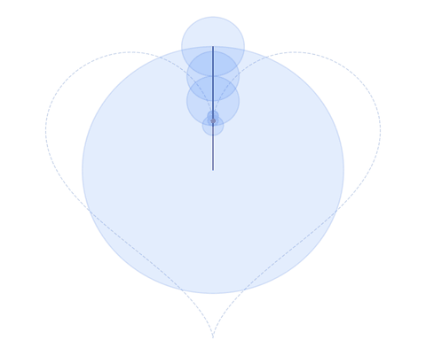
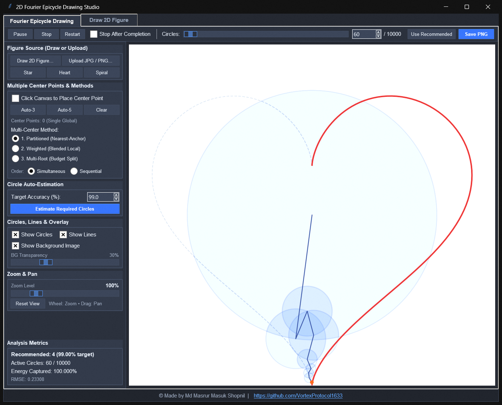
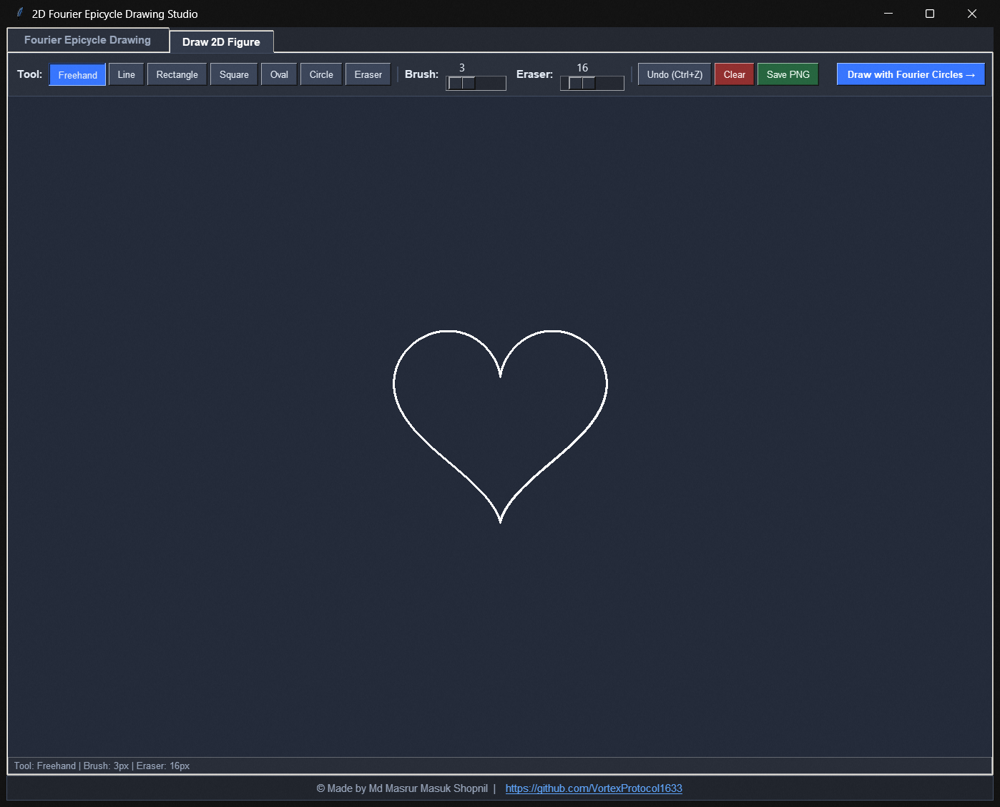
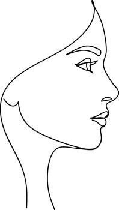
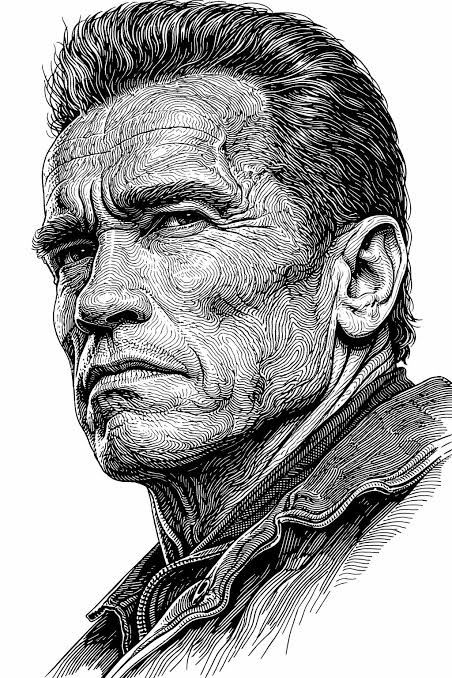

# 2D Fourier Epicycle Drawing Studio

An interactive desktop application that reconstructs any 2D line figure with rotating
Fourier epicycles — the same idea behind the famous "Fourier drawing" animations.

Sketch something on the built-in pad, upload a JPG/PNG, or pick a preset shape, and the
app traces the dark strokes into an ordered outline, decomposes it into harmonics with a
Discrete Fourier Transform, and animates the drawing as a chain of nested rotating circles.

Built with Python, Tkinter and Matplotlib.

## Screenshots

The heart preset traced from start to finish by a chain of up to 40 rotating Fourier circles:



The Fourier Epicycle Drawing tab — the same figure part-way through the animation:



The Draw 2D Figure tab — sketch pad with brush, shape, and eraser tools:



## Examples

The `examples/` folder contains sample inputs to try the app with — a simple line drawing
and a dense, highly detailed portrait:

| Simple input | Complex input |
| --- | --- |
|  |  |

Feed either file through **Upload JPG / PNG**, or draw your own figure, then slide the
circle count to trade detail for speed.

## Features

**Draw 2D Figure tab**

- Freehand brush, line, rectangle, square, oval, circle, and eraser tools
- Independent brush (1–30 px) and eraser (4–60 px) sizes with a live dashed eraser ring
- Undo history and one-click clear
- Export the sketch as a clean white-background / black-stroke PNG

**Fourier Epicycle Drawing tab**

- Preset shapes (star, heart, spiral) or upload a JPG/PNG to trace
- Live harmonic decomposition with a circle-count slider (1–10,000 components): all
  selected harmonics shape the traced path, while at most 40 circles are drawn at once so
  the animation stays readable
- Automatic circle estimation for a target accuracy percentage (50–99.99 %)
- Multiple center points with three strategies:
  - **Partitioned** — nearest-anchor contour splitting
  - **Weighted** — Gaussian-blended local epicycles with adjustable sigma
  - **Multi-Root** — budget split by harmonic energy or arc length
- Simultaneous or sequential playback ordering
- Toggle circles, radius lines, and the reference background overlay (with opacity)
- Zoom (25–400 %) with wheel zoom and drag-to-pan
- Metrics panel: recommended circles, active circles, captured energy, RMSE
- Export the finished Fourier figure as a 200 DPI PNG

## Requirements

- Python 3.10 or newer (`X | None` type syntax is used)
- `numpy`, `Pillow`, `matplotlib`
- Tkinter, which ships with most CPython installers. On Linux, install it separately:

  ```bash
  sudo apt install python3-tk    # Debian/Ubuntu
  ```

## Installation

Clone or download this repository, then from the project folder:

```bash
python -m venv .venv
source .venv/bin/activate        # Windows: .venv\Scripts\activate
pip install -r requirements.txt
```

Run the app:

```bash
python fourier_epicycle_studio.py
```

## Usage

1. Start on the **Draw 2D Figure** tab and sketch a figure, or switch to
   **Fourier Epicycle Drawing** and load a preset or upload an image.
2. Set a **Target Accuracy (%)** and press **Estimate Required Circles**, or drag the
   **Circles** slider manually.
3. Press **Pause**/**Play**, **Restart**, or **Stop** to control the animation.
4. Optionally enable **Click Canvas to Place Center Point** and use **Auto-3** / **Auto-5**
   to experiment with multi-center epicycles.
5. Use **Save PNG** to export either the sketch or the reconstructed figure.

### Tips for good uploads

- Use dark strokes on a light background (line art works best).
- Images are automatically downscaled to fit within 700 × 700 px (aspect ratio preserved)
  and normalized, so very large scans add no extra detail.
- Dense, highly hatched drawings need many more circles to resolve — expect a much
  higher `k` than a simple outline.

## How it works

1. The figure is converted to a binary mask of dark pixels, every connected stroke is
   traced and merged into one ordered path, then the path is resampled to a fixed number of
   points and normalized to the unit circle.
2. The path is treated as a complex signal `z(t) = x(t) + i·y(t)` and transformed with
   `np.fft.fft`. Components are sorted by amplitude, so the first `k` terms are the most
   visually important harmonics.
3. For each animation frame, every component contributes a rotating vector
   `cₙ · e^(i·2π·fₙ·t)`. Chaining those vectors from a center point draws the classic
   epicycle animation, and the tip of the chain traces the original figure.

## Keyboard shortcuts

| Shortcut | Action |
| --- | --- |
| `Ctrl+Z` | Undo the last stroke (Draw tab) |
| `Ctrl+S` | Save PNG (current tab) |
| Mouse wheel | Zoom the Fourier canvas |
| Left drag | Pan the Fourier canvas |

## Project structure

```
.
├── fourier_epicycle_studio.py   # entire application (UI, tracing, Fourier engine)
├── docs/                        # application screenshots used above
├── examples/                    # sample input images
│   ├── Simple.png
│   └── Complex.png
├── .github/workflows/ci.yml     # CI: compile + import check on Ubuntu (Python 3.10, 3.12)
├── .gitattributes               # LF line endings, binary rules for images
├── .gitignore
├── requirements.txt
├── LICENSE
└── README.md
```

## License

Released under the [MIT License](LICENSE).

## Author

**Md Masrur Masuk Shopnil** — [github.com/VortexProtocol1633](https://github.com/VortexProtocol1633)
